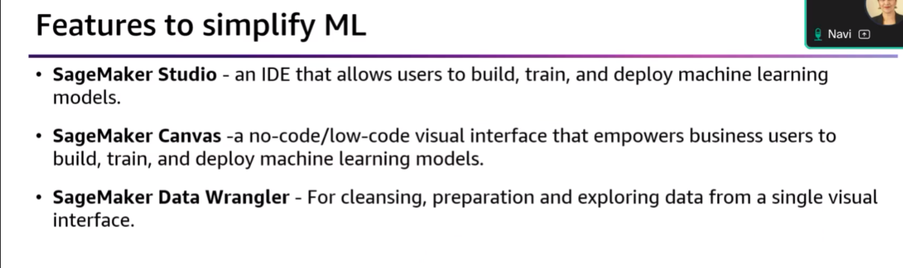
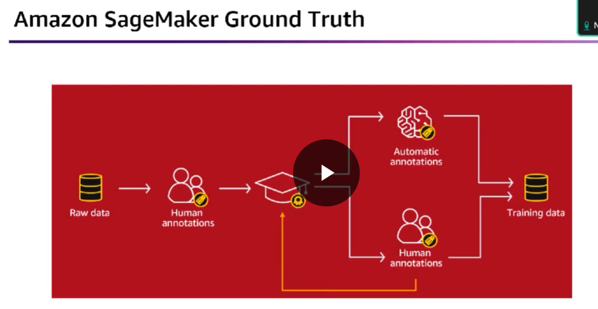
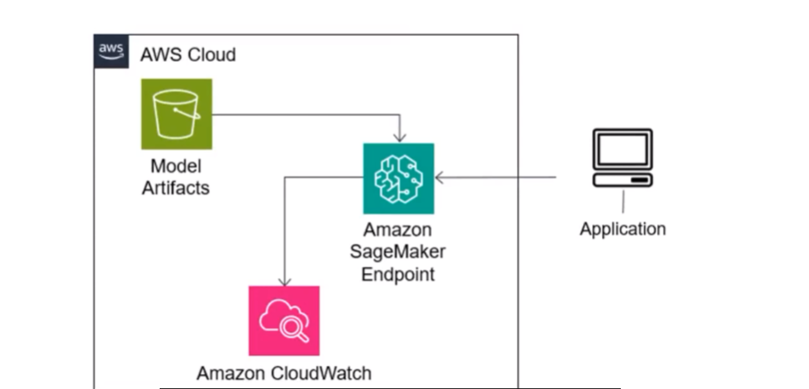
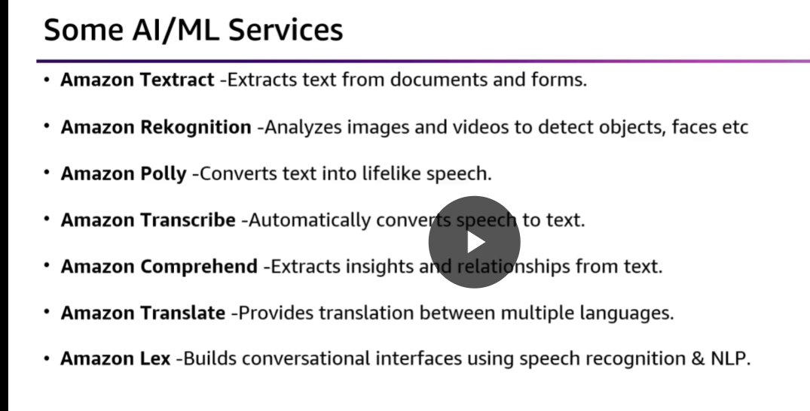
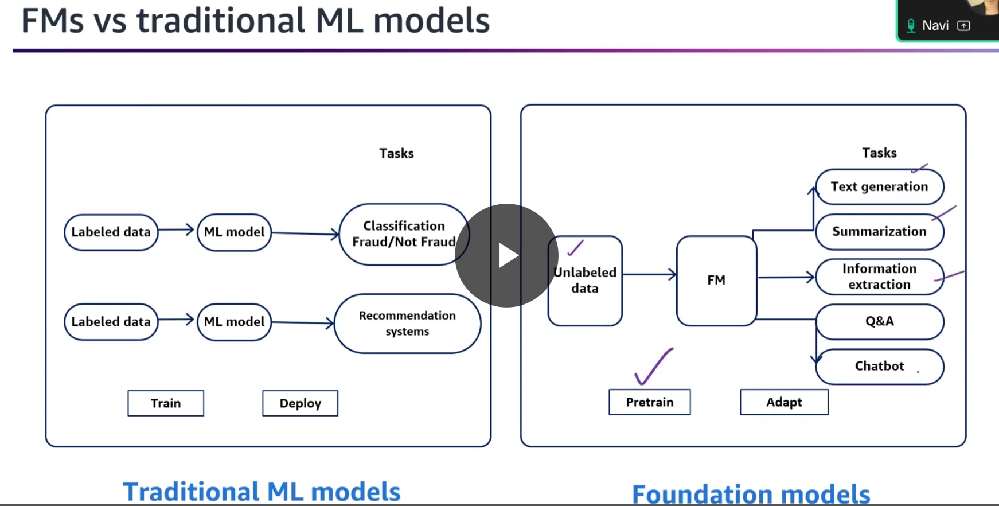

# Fundamentals of Generative AI 

diving into:
1. Amazon SageMaker
2. Amazon Bedrock
3. data preparation, model training, deployment, and monitoring

## SageMaker Data Wrangler
simplifies the process of building ml models and performing the following tasks
Import, Prepare, Transform, Vizualize, Analyze

## SageMaker Ground Truth

helps build high quality training data sets.
we can do automatic annotations as well and then send to humans to verify it.

## model deplyment

### real time inferencing 
live predictions, sustained traffic, low latency, consistent performance..

### batch transform
offline inference, large datasets

asynchronous inference- near real-time. 

## serverless inference
intermittent traffic, periods of no traffic, 

